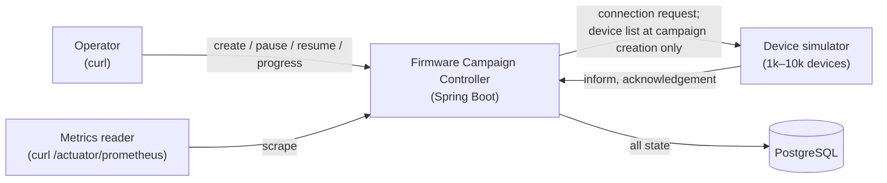
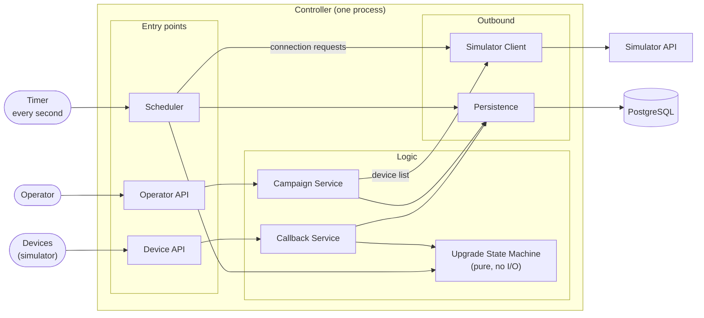
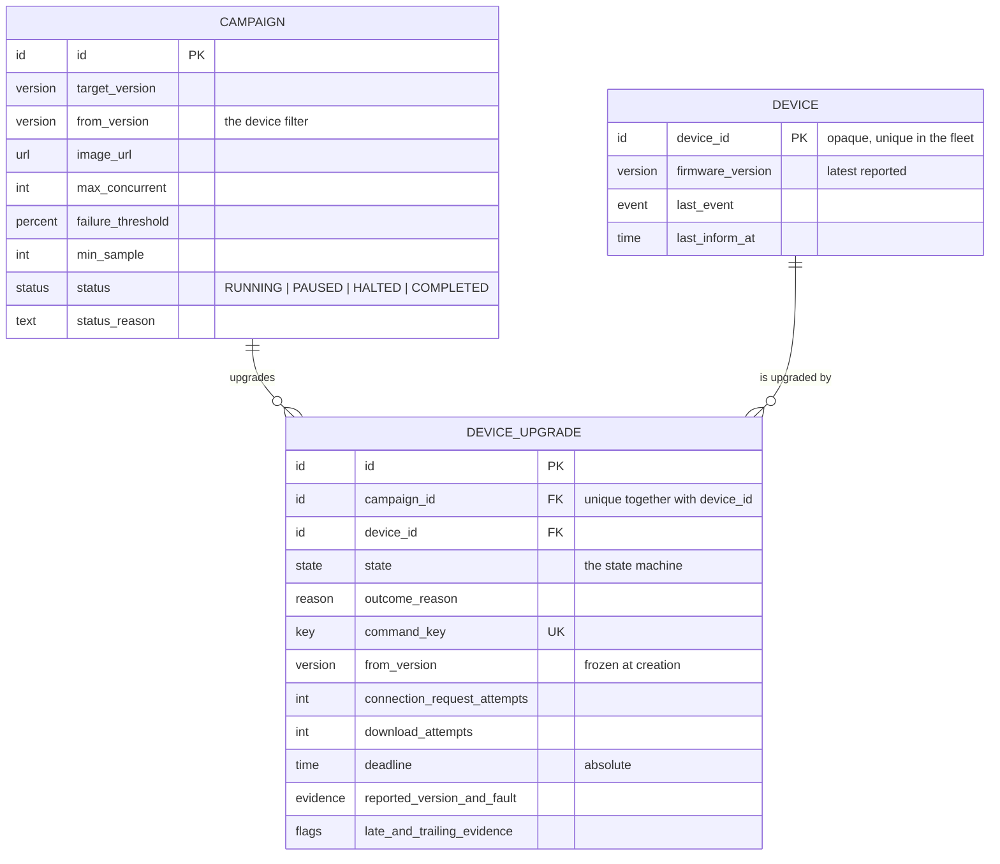
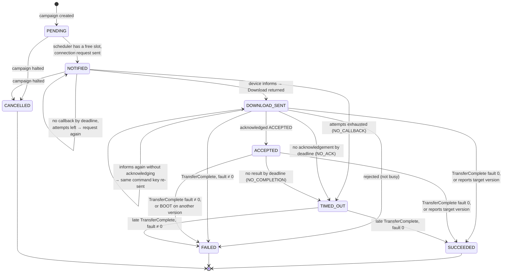
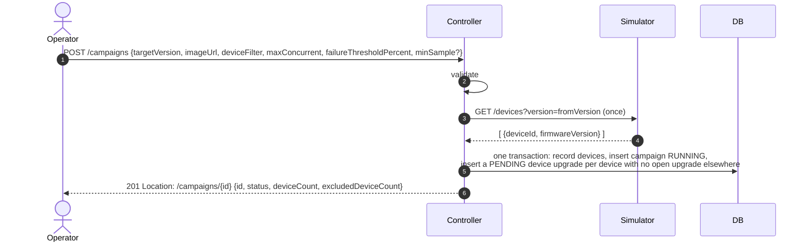
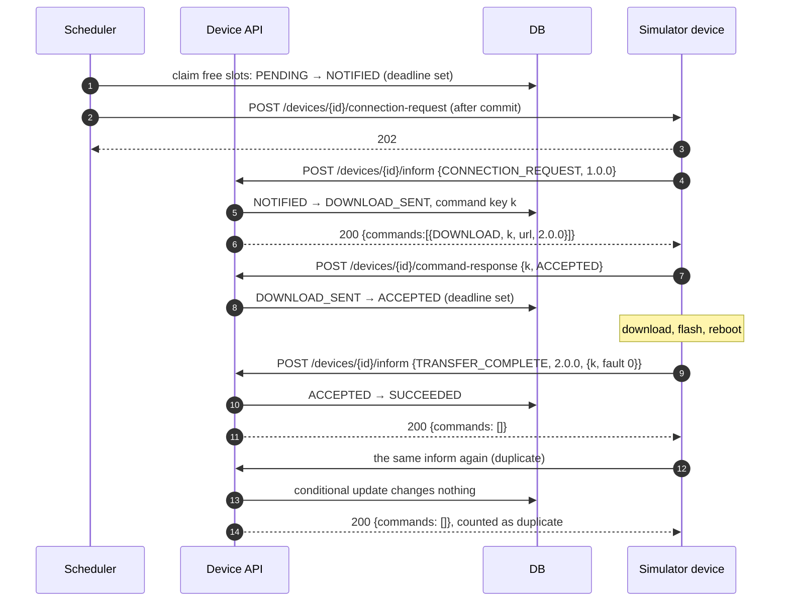
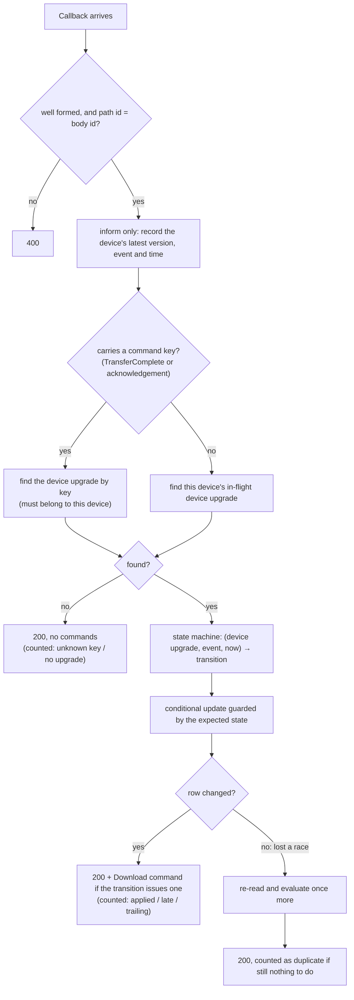
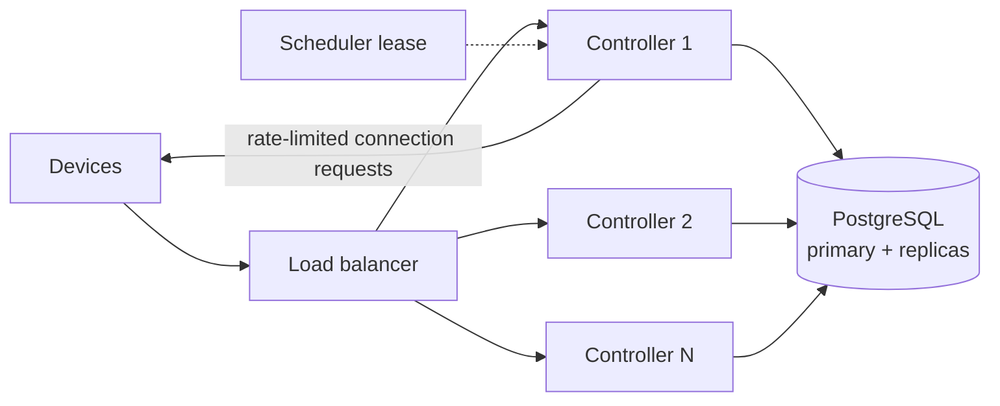

# Firmware Campaign Controller: High-Level Design

This document describes a controller that rolls a firmware upgrade out across a fleet of simulated home gateways. It is the single source of truth for the design. Domain terms are defined in the [glossary](GLOSSARY.md), and decisions that are hard to reverse are recorded in [docs/adr/](adr/). The device simulator is described in [simulator.md](simulator.md).

---

## 1. Context

### 1.1 The problem

A home gateway sits behind NAT, so the controller cannot open a connection to it. The controller can only send a **connection request** ("please call me"). The device then calls in with an **inform**, and the controller can hand it commands **only in the response to that call**.

A firmware upgrade spans several calls and a reboot:

1. The controller sends a connection request. A delivered request does not mean the device will call.
2. The device informs. The controller replies with a **Download** command carrying a unique **command key**.
3. The device **acknowledges** the command (accepted or rejected) in a separate call.
4. The device downloads, flashes and reboots. This takes seconds to minutes, and the controller hears nothing during that time.
5. The device informs again, normally with a **TransferComplete** that carries the same command key and a fault code.

The controller must correlate step 5 with step 2 across the reboot. It must also cope with devices that are offline, reject the command, fail, roll back, skip the TransferComplete, or send duplicate and late callbacks.

### 1.2 Goals

- Run a campaign that upgrades every eligible device, with a limit on how many are in flight at once.
- Track every device through an explicit state machine, and decide every outcome from evidence.
- Halt automatically when the failure rate gets too high.
- Survive a controller restart at any point.
- Make the controller observable through metrics and a progress API.
- Allow several campaigns at once, as long as each device is in only one ([ADR 0005](adr/0005-one-active-campaign-per-device.md)).

### 1.3 Non-goals

Authentication, a UI, multiple controller instances, a metrics server or dashboards, resuming a halted campaign, and upgrading a device on its own periodic inform (only the scheduler starts upgrades).

### 1.4 Constraints

- The device and simulator interfaces are fixed by the assignment.
- The simulator's device list may be read only when a campaign is created, never to poll for outcomes.
- It must run on a small single host. A run may take minutes.

---

## 2. Requirements traceability

| # | Requirement | Where it is met | How it is shown |
|---|---|---|---|
| R1 | Create and run a campaign | §6.1, §8.1, §9.1 | Demo run, 1k devices |
| R2 | Explicit state machine | §7 | Table-driven unit tests, one per transition |
| R3 | Correlate by command key; duplicates are idempotent | §7.3, §10.2 | Unit tests; integration test with a duplicate TransferComplete against Postgres; `result=duplicate` metric |
| R4 | Devices that come back without a TransferComplete | §7.2 | Unit tests; the reason breakdown matches the simulator's profile counts |
| R5 | Enforce `maxConcurrent` | §10.1 | The in-flight gauge never exceeds the limit during a run |
| R6 | Auto-halt on failure rate after a minimum sample | §10.4 | Demo run with a low threshold ends HALTED, with a reason |
| R7 | Timeouts at each waiting state, safe retries | §10.3 | Unit tests; offline devices end as `NO_CALLBACK` |
| R8 | Survive a restart | §10.5 | Demo: `kill -9` mid-run, restart, the campaign completes with consistent counts |
| R9 | Metrics by status code and endpoint | §10.6 | `/actuator/prometheus` |

---

## 3. System context



The controller has two callers (the operator and the devices) and two dependencies (PostgreSQL and the simulator). It never calls a device to give it a command. Commands travel only in its responses to informs.

---

## 4. Components



Read it left to right:
- Three things trigger work: an operator request, a device callback, or the scheduler's timer.
- Each trigger has one entry point.
- The logic layer decides what happens. The upgrade state machine is shared by device callbacks and the scheduler.
- Only two components talk to the outside world: Persistence talks to PostgreSQL, and the Simulator Client talks to the simulator.
- Metrics are recorded by every component and are left out of the diagram.

| Component | Responsibility |
|---|---|
| **Operator API** | The campaign endpoints (§9.1). Validates input and maps errors to status codes. |
| **Device API** | The inform and acknowledgement endpoints (§9.2). Always answers a well-formed callback with 200. |
| **Campaign Service** | Creates a campaign by taking a snapshot of the eligible devices. Handles pause and resume, and builds the progress view. |
| **Callback Service** | Records the device's latest facts, finds the device upgrade the callback belongs to, asks the state machine what happens, and writes the result. |
| **Upgrade State Machine** | Decides `(device upgrade, event, now) → transition`. Has no I/O and no clock of its own, so every rule can be unit-tested in isolation. |
| **Scheduler** | The only thing that starts device upgrades or acts on time. Each tick it expires deadlines, evaluates halts, fills free slots, sends connection requests and completes campaigns. |
| **Simulator Client** | Outbound HTTP to the simulator, with connect and read timeouts, retries on transport errors and 5xx only, and a bounded worker pool for connection requests. |
| **Persistence** | Every state change is one conditional update, guarded by the expected state ([ADR 0001](adr/0001-jdbcclient-conditional-updates.md)). |
| **Metrics** | Activity counters and progress gauges read from the database (§10.6). |

Two rules hold across all of these:
- **The database is the only state** ([ADR 0002](adr/0002-database-is-the-only-state.md)). No in-memory queue, counter or semaphore affects behaviour.
- **The state machine is the only place transition rules live.** The device callbacks and the scheduler both feed it events.

---

## 5. Tech stack

| Technology | Role |
|---|---|
| Java 21 | Language and runtime |
| Spring Boot 4.1 (Web MVC, JDBC `JdbcClient`, `RestClient`, scheduling) | REST endpoints, SQL access, outbound HTTP, the scheduler tick |
| PostgreSQL 16 | The only state. Provides row locks, `SKIP LOCKED` and partial unique indexes |
| Flyway | Versioned schema migrations |
| Spring Boot Actuator + Micrometer (Prometheus registry) | Health, metrics, Prometheus-format endpoint |
| Docker Compose | Runs PostgreSQL and the simulator |
| JUnit 5 | Unit and integration tests |
| Python 3 + FastAPI | The device simulator (provided) |

---

## 6. Domain model



- **Campaign:** the operator's intent. It doesn't change after creation, except for its status. It holds **no counters**: progress is always computed from its device upgrades, so it cannot drift and is correct immediately after a restart.
- **Device:** what we last heard from each device. It holds **current** facts only (version, last event, last seen) and is updated on every inform. It holds nothing about upgrades.
- **Device Upgrade:** one campaign's attempt on one device, and the only thing with a lifecycle. Its from version is **frozen** when the campaign is created. The rollback rule compares the reported version against this frozen value, never against the device's current version, which every inform overwrites.

Invariants:
- A device appears at most once per campaign: (campaign, device) is unique.
- A command key is unique across all device upgrades.
- A device has at most one **open** (pending or in-flight) device upgrade across all campaigns. Campaign creation enforces this ([ADR 0005](adr/0005-one-active-campaign-per-device.md)), and the database enforces it for in-flight device upgrades as a safety net.
- Deadlines are absolute timestamps, so a wait survives a restart unchanged.

---

## 7. Device upgrade lifecycle

### 7.1 States



| State | Meaning | Counts as |
|---|---|---|
| PENDING | Selected by the campaign, not started | Open |
| NOTIFIED | Connection request sent, waiting for the device to call | Open, in flight |
| DOWNLOAD_SENT | Download returned to the device, waiting for its acknowledgement | Open, in flight |
| ACCEPTED | Accepted, waiting for the result (downloading or rebooting) | Open, in flight |
| SUCCEEDED | Device is on the target version | Finished |
| FAILED | Device refused, faulted or came back on the wrong version | Finished |
| TIMED_OUT | Gave up waiting. Can still be corrected by late evidence | Finished |
| CANCELLED | The campaign halted before the device was given a Download (it was PENDING or NOTIFIED) | Neither (not counted in the failure rate) |

**There is no REBOOTING state.** The controller never observes a reboot starting. After the acknowledgement it hears nothing until the device informs again. A REBOOTING state would have no event to enter it, so ACCEPTED covers "downloading or rebooting".

### 7.2 Evidence rules (R4)

The rule is: **the first conclusive evidence decides the outcome**. In order of trust:

| Evidence | While waiting in | Outcome | Reason |
|---|---|---|---|
| TransferComplete with matching key, fault 0 | DOWNLOAD_SENT, ACCEPTED | SUCCEEDED | `TRANSFER_COMPLETE`. If the reported version is not the target, it is still a success: the version is stored and a mismatch metric is counted |
| TransferComplete with matching key, fault ≠ 0 | DOWNLOAD_SENT, ACCEPTED | FAILED | `FAULT` with the fault code |
| Any inform reporting the **target** version, no TransferComplete | DOWNLOAD_SENT, ACCEPTED | SUCCEEDED | `INFERRED_FROM_VERSION`. In DOWNLOAD_SENT this means the acknowledgement was lost (for example, the controller was down when it was sent) but the upgrade happened. The Download is never sent again to a device that already reports the target |
| **BOOT** on the **from** version, no TransferComplete | ACCEPTED | FAILED | `ROLLED_BACK` |
| **BOOT** on any other version, no TransferComplete | ACCEPTED | FAILED | `UNEXPECTED_VERSION` |
| PERIODIC or CONNECTION_REQUEST on the from version | ACCEPTED | no change | The device may still be downloading. Only a BOOT proves a reboot happened |
| Nothing by the deadline | ACCEPTED | TIMED_OUT | `NO_COMPLETION` |

Evidence can also arrive after an outcome is already known. **Only a TransferComplete with a matching command key can overturn an outcome**, because it is the device reporting the result of *our* command. Anything else is recorded but does not change the outcome.

- **Late evidence:** a matching TransferComplete for a TIMED_OUT device upgrade. It **replaces** the timeout with the real outcome. The concurrency slot is not taken again.
- **Trailing evidence:** later evidence that is **recorded** but does **not** change the outcome:
  - A matching TransferComplete for a device upgrade that already SUCCEEDED or FAILED on other evidence. Its fault code is stored. For example, a device that came back on its old version and was failed as `ROLLED_BACK` may later send a TransferComplete with fault 9010. The progress view shows "ROLLED_BACK, fault 9010 reported later".
  - An inform reporting the **target** version for a device upgrade that TIMED_OUT **after it was given a Download** (`NO_ACK` or `NO_COMPLETION`). The reported version is stored and the device upgrade stays TIMED_OUT. The device did upgrade but did not follow the protocol (it never acknowledged, or never reported a result), so it is flagged for investigation and still counts as a failure. `NO_CALLBACK` is excluded: that device was never given a Download, so its version says nothing about this campaign.

Any inform that carries a TransferComplete payload is treated as a TransferComplete, whatever its `event` field says.

### 7.3 Acknowledgements and correlation (R3)

- The command key is generated **once**, when the device upgrade first moves to DOWNLOAD_SENT. If the device informs again without acknowledging, the **same** key is sent again (at most twice in total). A TransferComplete therefore always correlates, whichever copy the device acted on.
- An acknowledgement or TransferComplete is matched by **command key**, and the key must belong to the calling device. An unknown key is answered with 200 and counted. It never fails. This should not happen in a normal run, but it can: the database was reset while devices were mid-upgrade, the key belongs to a different device, or the download was started by another system.
- **A rejection is final, except a busy rejection.** A device that is already downloading rejects a repeated Download with reason `BUSY`. That happens when a duplicated inform makes us re-send while the first Download is still running. A busy rejection leaves the device upgrade where it is: the real acknowledgement, the TransferComplete or the deadline decides.
- An acknowledgement for a device upgrade that has left DOWNLOAD_SENT is a duplicate, and nothing changes.

---

## 8. Key flows

### 8.1 Creating a campaign



If no device is eligible, the campaign is created as COMPLETED with zero devices.

### 8.2 Happy path



### 8.3 How every callback is processed



A PENDING device upgrade ignores informs. Only the scheduler starts an upgrade.

---

## 9. API contracts

### 9.1 Operator API

| Endpoint | Success | Errors |
|---|---|---|
| `POST /campaigns` | 201, `Location` header, campaign body | 400 invalid input; 502 the simulator's device list failed |
| `GET /campaigns` | 200, list of campaign summaries | n/a |
| `GET /campaigns/{id}` | 200, progress (below) | 404 |
| `POST /campaigns/{id}/pause` | 200, campaign body | 404; 409 if not RUNNING |
| `POST /campaigns/{id}/resume` | 200, campaign body | 404; 409 if not PAUSED (a HALTED campaign cannot be resumed) |

**Request:** `{ targetVersion, imageUrl, deviceFilter: { currentVersion }, maxConcurrent, failureThresholdPercent, minSample? }`. Validation:
- the versions and the URL are required,
- the target version must differ from the current version,
- `maxConcurrent` ≥ 1,
- `failureThresholdPercent` is between 0 and 100,
- `minSample` ≥ 1 and defaults to 50.

**Progress response:**

```json
{
  "id": "7f3c…", "status": "HALTED",
  "statusReason": "failure rate 24.0% > 20% after 50 finished",
  "targetVersion": "2.0.0", "fromVersion": "1.0.0",
  "maxConcurrent": 100, "inFlight": 32,
  "deviceCount": 1000, "excludedDeviceCount": 0,
  "countsByState": { "PENDING": 0, "NOTIFIED": 0, "DOWNLOAD_SENT": 2, "ACCEPTED": 30,
              "SUCCEEDED": 38, "FAILED": 9, "TIMED_OUT": 3, "CANCELLED": 918 },
  "reasons": { "TRANSFER_COMPLETE": 36, "INFERRED_FROM_VERSION": 2, "REJECTED": 4,
               "FAULT": 3, "ROLLED_BACK": 2, "NO_CALLBACK": 3 },
  "trailingEvidence": { "ROLLED_BACK": { "FAULT_9010": 1 },
                        "TIMED_OUT": { "REPORTED_TARGET_VERSION": 1 } },
  "failureRate": 0.24, "failureThresholdPercent": 20, "minSample": 50
}
```

### 9.2 Device API

| Endpoint | Response |
|---|---|
| `POST /devices/{deviceId}/inform` | 200 `{ commands: [] }` or `{ commands: [ { type: "DOWNLOAD", commandKey, url, targetVersion } ] }` |
| `POST /devices/{deviceId}/command-response` | 200 with an empty body |

**A well-formed callback always gets 200.** That includes an unknown device, an unknown key, a duplicate, late or trailing evidence, and a busy rejection. An error response would only make the device retry something we have already decided. The endpoints return **400** for a malformed body or when the path and body device ids differ, and **503** if the database is unavailable. In that last case the device's own retry, or its next periodic inform, recovers.

---

## 10. Cross-cutting concerns

### 10.1 Concurrency limit (R5)

- The **scheduler is the only path into the in-flight set.** Callbacks only move device upgrades forward or out of it.
- On each tick, for each RUNNING campaign, the scheduler locks the campaign and counts its in-flight device upgrades. It then claims at most `maxConcurrent − inFlight` PENDING ones.
- Slot claims are serialised per campaign by the lock. The count comes from the database. So the limit holds across ticks, concurrent callbacks and restarts.
- Connection requests are sent **after** the claim commits. A device can therefore never call back before its device upgrade is visible as NOTIFIED.

### 10.2 Idempotency (R3)

- Every transition is **one conditional update** guarded by the state the decision was based on ([ADR 0001](adr/0001-jdbcclient-conditional-updates.md)). Of two concurrent copies of the same callback, exactly one changes the row.
- The loser re-reads the row and evaluates once more. Usually there is nothing left to do, and the callback is counted as a duplicate.
- Transition metrics are counted only when a row actually changed, so duplicates never inflate them.

### 10.3 Timeouts and retries (R7)

The rule: **repeat what is idempotent; never repeat what changes the device.**

| Waiting in | Waiting for | Default deadline | On deadline | Retry? |
|---|---|---|---|---|
| NOTIFIED | the device to call in | 30 s | Send another connection request (2 in total), then TIMED_OUT `NO_CALLBACK` | **Yes.** A connection request has no side effect |
| DOWNLOAD_SENT | the acknowledgement | 30 s | TIMED_OUT `NO_ACK` | **Only when the device informs again**, and only with the same key (2 sends in total) |
| ACCEPTED | TransferComplete or version evidence | 300 s | TIMED_OUT `NO_COMPLETION` | **Never.** The device may be flashing; a second Download risks a double flash |
| Any outbound HTTP call | the simulator's response | connect 2 s, read 5 s | Retry up to 2 times on transport errors and 5xx; never on 4xx | **Yes**, for the reasons above |

All values are configurable. The 300 s result wait covers the simulator's worst case of 260 s (download plus reboot).

### 10.4 Auto-halt (R6)

- **Failure rate** = (FAILED + TIMED_OUT) / finished. CANCELLED is excluded. Timeouts count, including offline devices ([ADR 0003](adr/0003-timeouts-count-toward-failure-rate.md)).
- On every tick, for each RUNNING or PAUSED campaign: if finished ≥ `minSample` **and** the rate is above the threshold, the campaign becomes **HALTED** with a readable reason. In the same transaction, every device upgrade that has not yet been given a Download (PENDING or NOTIFIED) becomes **CANCELLED**. A device that answers a connection request after the halt gets no command.
- Device upgrades that already have a Download (DOWNLOAD_SENT, ACCEPTED) run on to their outcome. A device part-way through flashing is never abandoned.
- The halt check runs before slot filling in each tick, so a breached campaign dispatches nothing more.
- **Pause vs halt:** both stop new dispatches. Pause is an operator action and can be resumed. In-flight device upgrades continue normally while paused, including handing a Download to a NOTIFIED device that calls in. Halt is automatic and cancels everything that has not been given a Download.
- A RUNNING campaign becomes **COMPLETED** when it has no open device upgrades.

### 10.5 Restart survival (R8)

Everything that affects behaviour is in the database ([ADR 0002](adr/0002-database-is-the-only-state.md)): states, attempt counts, command keys and absolute deadlines.

After a restart:
- The first tick times out or retries anything overdue, then refills free slots.
- A connection request lost in the crash is covered by the NOTIFIED retry.
- Callbacks that arrived while the controller was down are recovered by the device's next inform, because the command key is stored.

### 10.6 Observability (R9)

| Metric | Tags | Answers |
|---|---|---|
| `http.server.requests` (built in) | `uri`, `method`, `status`, `outcome` | Inbound traffic per endpoint and status code |
| `http.client.requests` (built in) | `uri`, `status`, `outcome` | Outbound traffic to the simulator |
| `dm_outbound_requests_total` | `endpoint` (connection_request, list_devices), `status` (code or IO_ERROR) | Requests sent and errored, including transport errors that have no status code |
| `dm_callbacks_total` | `endpoint`, `event`, `result` (applied, duplicate, unknown_key, late, trailing, busy_rejection, ignored) | How device callbacks were handled |
| `dm_transitions_total` | `from`, `to`, `reason` | Every state change, counted once |
| `dm_commands_issued_total` | `reissue` | Downloads sent, first copy vs repeat |
| `dm_version_mismatch_total` | n/a | Successes that reported an unexpected version |
| `dm_devices` (gauge) | `campaign`, `state` | Progress by state, read from the database |
| `dm_campaign_failure_rate` (gauge) | `campaign` | Current failure rate, read from the database |

Counters describe **activity** and reset on restart. Gauges describe **state**, are read from the database, and stay correct. The controller also logs one progress line per active campaign every 10 s.

---

## 11. Decisions

| Decision | Record |
|---|---|
| Plain SQL with conditional updates instead of an ORM | [ADR 0001](adr/0001-jdbcclient-conditional-updates.md) |
| The database is the only state | [ADR 0002](adr/0002-database-is-the-only-state.md) |
| Timeouts count toward the failure rate | [ADR 0003](adr/0003-timeouts-count-toward-failure-rate.md) |
| A device belongs to at most one active campaign | [ADR 0005](adr/0005-one-active-campaign-per-device.md) (supersedes [ADR 0004](adr/0004-one-active-campaign.md)) |
| No REBOOTING state | §7.1 |
| First conclusive evidence wins; only a matching TransferComplete overturns an outcome (late evidence); everything after is recorded only (trailing evidence) | §7.2 |
| A busy rejection is temporary | §7.3 |
| Only the scheduler starts upgrades | §8.3, §10.1 |
| A halted campaign cancels every device upgrade not yet given a Download, and cannot be resumed | §10.4 |

---

## 12. Scaling and extensions

### 12.1 Deployment for this assignment

One controller process, one PostgreSQL instance, one simulator. Device callbacks are already safe across several controller instances, because every write is a conditional update in the database. The scheduler tick is the only part that assumes a single instance.

### 12.2 From 10k to 1M–10M devices

| Bottleneck | What breaks | Mitigation |
|---|---|---|
| One scheduler tick | One process expires and dispatches for every campaign | A lease so exactly one instance runs the tick, then partition the work by campaign or device hash. Slot claims with `SKIP LOCKED` are already safe to run concurrently |
| Connection-request fan-out | Millions of requests, most to devices that will inform anyway | **Pull-model dispatch:** hand out the Download when a device makes its regular periodic inform, inside a maintenance window. Rate-limit the remaining connection requests |
| Inform bursts | Request threads and database connections run out | A queue in front of ingestion. Under pressure, shed PERIODIC informs first (the device will call again) and never shed BOOT or TransferComplete |
| One device-record write per inform | Write load and table churn | Batch or asynchronously update the device record. It is already written in exactly one place |
| Progress counted with `GROUP BY` | Slow on very large campaigns | Counters maintained incrementally in the same transaction as each transition |
| Per-campaign limits only | No fleet-wide cap on concurrent downloads | Fleet-wide slot counters leased in blocks to each instance |
| Device identity | A flat `deviceId` namespace | Identify devices by manufacturer OUI plus serial number, scoped by tenant |



### 12.3 Extensions

- **Staged rollout:** a canary at 1%, then 10%, then 100%, each stage gated on the previous one's success rate.
- **Per-segment caps:** limits per hardware model or region, so one segment cannot use the whole budget.
- **Pull-model scheduling** (above), for fleets where connection requests are expensive or unreliable.
- **Resume after halt with a new threshold**, evaluated only on outcomes after the resume.

---

## 13. Known limits

- A campaign with fewer finished device upgrades than `minSample` can never halt. Small campaigns are effectively canaries that a human watches.
- The early failure rate reads high. Rejections finish in seconds and offline devices in about a minute, while successes take minutes (download plus reboot). So the first `minSample` finished upgrades over-represent failures. A rough estimate with the simulator's defaults: the true failure rate is about 14%, but the rate after the first 50 finishes is closer to 30%. A threshold in the 20–30% range can therefore halt a campaign that would have finished well under it. A larger `minSample` reduces the effect.
- Offline devices count as failures ([ADR 0003](adr/0003-timeouts-count-toward-failure-rate.md)). A fleet with many unreachable devices can halt a campaign even when the image is fine. The reason breakdown shows why.
- A device that upgraded but timed out (it never acknowledged, or never reported a result) stays TIMED_OUT and counts as a failure. Its reported version is kept as trailing evidence, so the progress view lists it for investigation.
- Activity counters reset on restart. Progress gauges do not.
- One controller instance. Scaling out needs the scheduler lease described in §12.2.
- A PENDING device that informs on its own is not upgraded until the scheduler reaches it.
- With the simulator's default settings, *late evidence after a timeout* is rare in a live run: the device's early BOOT usually finishes the device upgrade first. Unit tests cover the transition directly.


